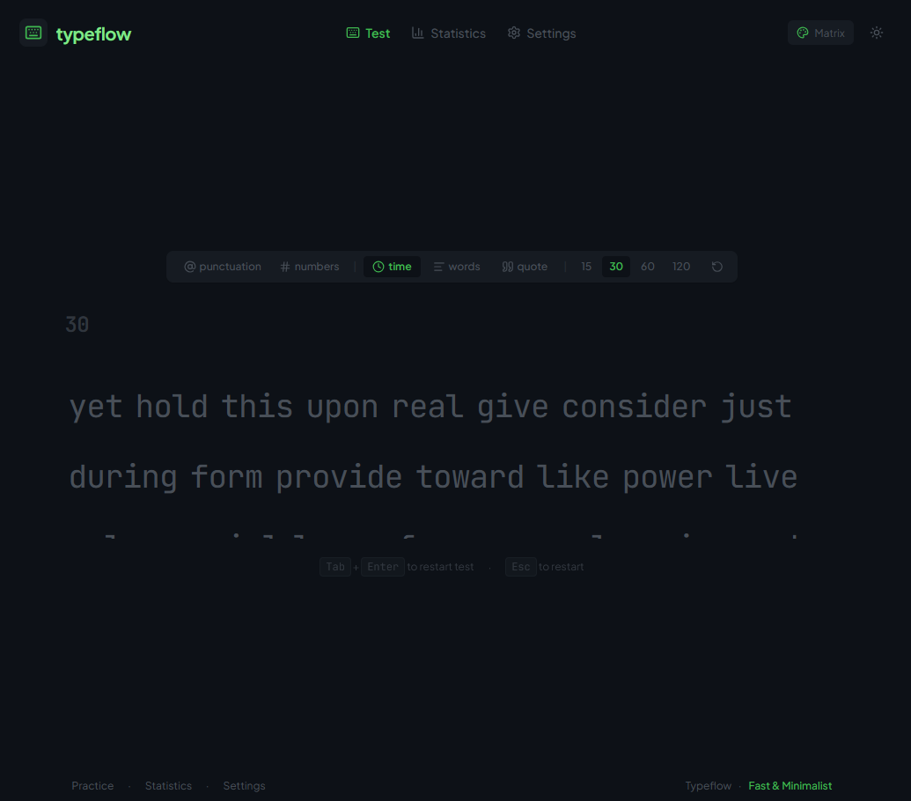

# Typeflow

A minimalist, high-performance typing speed test application built to help users improve their typing speed, accuracy, and consistency. Inspired by the clean aesthetics and responsive mechanics of Monkeytype, featuring a distraction-free interface, 9 customizable themes, real-time statistics, mechanical switch audio feedback, and a keyboard-first experience.

<p align="center">
  
  
  
  
  
  
  
</p>

<p align="center">
  
</p>

## ⚡ Features

- **Typing Speed Test** — Accurately measure typing speed in words per minute (WPM), Raw WPM, accuracy percentage, and typing consistency.
- **Real-Time Live Statistics** — Watch dynamic real-time WPM, accuracy, and countdown timers update with zero input latency.
- **Multiple Test Modes**:
  - **Time Mode**: 15s, 30s, 60s, or 120s countdown tests with continuous infinite word buffer refills.
  - **Words Mode**: 10, 25, 50, or 100 fixed target word challenges.
  - **Quote Mode**: Carefully curated famous quotes categorized into short, medium, and long lengths.
- **Punctuation & Numbers Toggles** — Seamlessly inject capital letters, punctuation marks, and numbers into test word pools.
- **Strict Mode & Backspace Options** — Toggle strict mode requiring all errors to be resolved before advancing.
- **Interactive Typing Interface** — Real-time smooth sliding caret, active word highlighting, letter error indicators, and automatic multi-line viewport scrolling.
- **9 Curated Themes** — Switch instantly between Serika Dark, Carbon, Nord, Dracula, Matrix, Taro, Midnight, Paper Light, and Light.
- **Mechanical Audio Feedback** — Web Audio API synthesized mechanical keyboard sound effects (Click, Pop, Clack, Beep) with custom volume control.
- **Results Summary & Visual Charts** — Detailed post-test summary with an interactive Recharts timeline showing WPM, Raw WPM, and error markers across every second.
- **Personal Statistics & History** — View average WPM, best WPM, total tests completed, time typed, and individual test records stored in Local Storage.
- **Keyboard-Focused Experience** — Restart immediately with <kbd>Tab</kbd> + <kbd>Enter</kbd> or <kbd>Esc</kbd>.
- **Clean Architecture** — Fully modular state management using React Context API (`AppProviders`, `SettingsContext`, `TestHistoryContext`, `AppNavigationContext`, `TypingTestContext`).

## 🚀 Getting Started

Follow these steps to run the project locally.

### Prerequisites

Make sure you have installed:
- [Node.js](https://nodejs.org/) (version 18+ recommended)
- npm, pnpm, or bun

### Installation

1. **Clone the repository**
   ```bash
   git clone https://github.com/YOUR_USERNAME/typeflow.git
   ```

2. **Navigate to the project directory**
   ```bash
   cd typeflow
   ```

3. **Install dependencies**
   ```bash
   npm install
   ```

4. **Start the development server**
   ```bash
   npm run dev
   ```
   Open [http://localhost:3000](http://localhost:3000) in your browser.

### Production Build

To create an optimized production build:
```bash
npm run build
```

To preview the production build locally:
```bash
npm run preview
```

---

## 🏗️ Project Structure

The codebase is organized into domain-specific modules, contexts, and reusable components:

```text
typeflow/
├── public/
│   └── typeflow.png                 # Application preview banner
├── src/
│   ├── components/
│   │   ├── Header.tsx               # Wordmark, quick theme toggle, and view navigation
│   │   ├── TestConfiguration.tsx    # Mode, duration, and punctuation/numbers toolbar
│   │   ├── LiveStatistics.tsx       # Live countdown timer, live WPM, and accuracy indicators
│   │   ├── TypingArea.tsx           # Multi-line word canvas, letters, and smooth caret
│   │   ├── ResultsScreen.tsx        # Post-test performance metrics and Recharts timeline
│   │   ├── HistoryStatsView.tsx     # Personal records, stats cards, and historical test log
│   │   └── SettingsView.tsx         # Comprehensive configuration panel
│   ├── contexts/
│   │   ├── AppNavigationContext.tsx # Active view state ('test' | 'history' | 'settings')
│   │   ├── SettingsContext.tsx      # User preferences, themes, and sound settings
│   │   ├── TestHistoryContext.tsx   # Saved test records and history persistence
│   │   └── TypingTestContext.tsx    # Core typing engine, timer refs, input tracking & stats
│   ├── hooks/
│   │   ├── useAppNavigation.ts      # Navigation consumer hook
│   │   ├── useSettings.ts           # Settings and theme consumer hook
│   │   ├── useTestHistory.ts        # Test history consumer hook
│   │   └── useTypingTest.ts         # Active typing test state and handlers hook
│   ├── providers/
│   │   └── AppProviders.tsx         # Ordered composition of all application contexts
│   ├── constants/
│   │   └── themes.ts                # Theme palettes, color definitions, and CSS variable injector
│   ├── types/
│   │   └── index.ts                 # Shared TypeScript interfaces and types
│   ├── utils/
│   │   ├── audio.ts                 # Web Audio API sound synthesis
│   │   ├── calculateStats.ts        # Pure deterministic WPM, accuracy, and consistency math
│   │   ├── storage.ts               # LocalStorage read/write handlers
│   │   └── textGenerator.ts         # Word dictionary, quote library, and generator
│   ├── App.tsx                      # Root composition layer with global shortcuts
│   ├── main.tsx                     # React application entry point
│   └── index.css                    # Tailwind CSS v4 setup and global styles
├── index.html                       # HTML5 entry with preconnected typography
├── package.json                     # Scripts and dependencies
├── tsconfig.json                    # TypeScript compiler configuration
└── README.md
```

---

## 🎨 Theme System

Typeflow uses a centralized theme configuration to manage the application's color palette. Colors are applied dynamically to `document.documentElement` through CSS custom variables, updating the entire UI instantaneously without page reloads.

Each theme defines the following variables:

| CSS Variable | Property | Purpose |
|---|---|---|
| `--bg-color` | `bg` | Main page background |
| `--main-color` | `main` | Primary accent color (active modes, caret, graphs) |
| `--caret-color` | `caret` | Typing cursor color |
| `--sub-color` | `sub` | Muted text, secondary buttons, and inactive indicators |
| `--sub-alt-color` | `subAlt` | Secondary surfaces, toolbars, and card backgrounds |
| `--text-color` | `text` | Primary foreground text |
| `--error-color` | `error` | Incorrectly typed characters |
| `--error-extra-color` | `errorExtra` | Overtyped extra characters |

### Included Themes
- **Serika Dark** (default): Warm amber on dark charcoal
- **Carbon**: Neutral monochrome dark
- **Nord**: Arctic icy blue palette
- **Dracula**: Classic neon pink and purple
- **Matrix**: Phosphor terminal green on pure black
- **Taro**: Soft pastel lavender and violet
- **Midnight**: Deep ocean blue and indigo
- **Paper Light**: Warm cream and ink light mode
- **Light**: Crisp minimalist clean daylight theme

---

## 📊 Typing Statistics & Formulas

Calculations follow the standard international typing test conventions where one word equals **5 keystrokes**:

### Net Words Per Minute (WPM)
$$\text{Net WPM} = \frac{\text{Correct Characters}}{5 \times \text{Elapsed Minutes}} = \frac{\text{Correct Characters}}{5} \times \frac{60}{\text{Elapsed Seconds}}$$

### Raw Words Per Minute (Raw WPM)
$$\text{Raw WPM} = \frac{\text{Total Keystrokes}}{5 \times \text{Elapsed Minutes}} = \frac{\text{Total Keystrokes}}{5} \times \frac{60}{\text{Elapsed Seconds}}$$

### Accuracy
$$\text{Accuracy} = \frac{\text{Correct Characters}}{\text{Total Keystrokes}} \times 100\%$$

### Consistency
Calculated using the coefficient of variation across keystroke interval timings throughout the test, normalized to a percentage scale from 0% to 100%.

---

## ⌨️ Keyboard Shortcuts

| Shortcut | Action |
|---|---|
| <kbd>Tab</kbd> + <kbd>Enter</kbd> | Restart or refresh the current test |
| <kbd>Esc</kbd> | Restart test / Return to practice screen from stats or settings |
| <kbd>Space</kbd> | Submit active word and advance to next word |
| <kbd>Backspace</kbd> | Correct previous character (or step back to previous word) |
| <kbd>Ctrl</kbd> / <kbd>Alt</kbd> + <kbd>Backspace</kbd> | Erase whole current word input |

---

## 📜 Available Scripts

| Command | Description |
|---|---|
| `npm run dev` | Start the development server at `http://localhost:3000` |
| `npm run build` | Build production assets to `/dist` |
| `npm run preview` | Preview production build locally |
| `npm run lint` | Run TypeScript type checks (`tsc --noEmit`) |
| `npm test` | Run the deterministic typing engine test suite (`tsx src/utils/calculateStats.test.ts`) |

---

## 🧪 Testing

The typing engine is verified through a test suite checking 10 distinct typing scenarios:
- Standard continuous typing calculations
- Accuracy penalty validation
- Backspace corrections handling
- Uncorrected error tracking
- Sub-second / zero-time edge cases
- Early completion in word mode
- Fixed duration time mode completion
- Restart state isolation
- Rapid keystroke consistency
- Consistency variance stability

Run the test suite with:
```bash
npm test
```

---

## 📄 License

This project is licensed under the Apache License 2.0.
